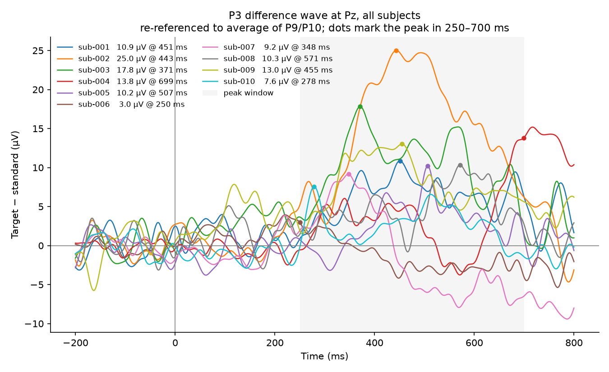

# P3 oddball decoding on ERP CORE

Single-trial classification of target versus standard stimuli from the P3
component of the ERP CORE visual oddball task, for ten subjects. The question:
**can a linear classifier trained on the P3 window decode targets from single
epochs, and does a decoder trained on other people transfer to a new person?**

Short answer: within a subject, yes, modestly (mean ROC-AUC 0.73). Across
subjects, barely (leave-one-subject-out ROC-AUC 0.59), and the ERP survey shows
why: P3 latency, amplitude and even sign differ enough between people that one
set of weights does not fit everyone.

`NOTES.md` is the detailed working log, with every number, decision and
open item. This README is the summary.

## Dataset

[ERP CORE](https://erpinfo.org/erp-core) (Kappenman et al., 2021) is an open
resource of optimised paradigms and data from 40 neurotypical adults for seven
ERP components. This project uses the **P3 active visual oddball** task, raw
BIDS-format data from the OSF project (`thsqg`, P3 component `etdkz`).

Letters A–E appear in random order, each with probability .2. One letter is the
designated target in each block, so target probability is .2 and the same
physical stimulus is a target in some blocks and a non-target in others.
Participants respond target / non-target on every trial. Each subject has 200
stimulus events: 40 targets, 160 standards.

| Property | Value |
|---|---|
| Amplifier | BioSemi ActiveTwo |
| Sampling rate | 1024 Hz |
| Channels | 30 EEG + 3 EOG |
| Reference as recorded | CMS (BioSemi common mode sense) |
| Subjects used | sub-001 to sub-010 (of 40) |

Stimulus event codes are two digits `XY`: `X` is the block's target letter,
`Y` the letter shown, so `X == Y` is a target. The scheme is documented in the
dataset's own `task-P3_events.json`.

### Download

`osf_download.py` fetches subject folders through the OSF API into `data/`,
checking each file's size and MD5 against what the API reports. Files already
present and intact are skipped.

```bash
python osf_download.py          # sub-002 to sub-010 (the default range)
python osf_download.py 1 10     # all ten subjects used here
python osf_download.py 11 40    # the remaining thirty
```

Each subject is seven files in `data/sub-XXX/eeg/`, about 45–75 MB of which is
the `.fdt` data file.

## Setup

```bash
python -m venv venv
source venv/bin/activate
pip install -r requirements.txt   # MNE, scikit-learn, matplotlib, numpy
```

## Pipeline

| Script | What it does |
|---|---|
| `prepare_epochs.py` | Load one subject, retype the three EOG channels, bandpass 0.1–30 Hz (zero-phase FIR), re-reference EEG to the average of P9/P10, label targets from the event codes, epoch −200 to +800 ms with a pre-stimulus baseline. Importable as `prepare_epochs(subject)`. |
| `features.py` | `extract_features()`: mean amplitude in 50 ms bins per EEG channel, flattened to one row per epoch. The *restricted* set used for all reported results is 7 centro-parietal channels (Cz, CPz, Pz, P3, P4, PO3, PO4) over 300–600 ms, 42 features. |
| `classify.py` | Within-subject stratified 5-fold CV for every subject: `StandardScaler` + shrinkage LDA, class-frequency priors versus equal priors, plus a dummy baseline. |
| `cross_subject.py` | Pools all subjects: leave-one-subject-out, with and without per-subject standardisation, against the within-subject scores; plus a leaky pooled 5-fold as an upper bound. |
| `plot_erp.py` | Target and standard averages at Pz for one subject. |
| `plot_erp_all.py` | Pz difference wave (target − standard) for every subject on one axis, peak marked. |

Two choices matter most:

- **Reference.** The data are recorded on BioSemi's CMS, which is not a usable
  EEG reference: as recorded, target and standard averages at Pz nearly
  coincide. Re-referencing to the average of P9/P10 (the ERP CORE convention
  for P3) raises the target − standard peak from 2 to 11 µV.
- **Feature window and site.** 300–600 ms is the a priori P3 window from
  Kappenman et al. (2021), Table 2. They measure at Pz alone; the 7-channel
  cluster around Pz is this project's choice, not theirs.

Classifier: `StandardScaler` + `LinearDiscriminantAnalysis(solver="lsqr",
shrinkage="auto", priors=[0.5, 0.5])`, scored by ROC-AUC and balanced
accuracy. Equal priors were adopted after showing that the default
class-frequency priors (about .8 / .2) put the decision threshold too far
towards "standard": balanced accuracy rose in 9 of 10 subjects (mean 0.61 to
0.67) with ROC-AUC unchanged.

## Results

### Within-subject

Stratified 5-fold CV per subject, restricted features, equal priors. Mean ± SD
across folds; the mean row is across the ten subjects.

| Subject | ROC-AUC | Balanced accuracy |
|---|---|---|
| sub-001 | 0.714 ± 0.077 | 0.634 ± 0.066 |
| sub-002 | 0.896 ± 0.096 | 0.797 ± 0.111 |
| sub-003 | 0.780 ± 0.053 | 0.684 ± 0.052 |
| sub-004 | 0.866 ± 0.089 | 0.797 ± 0.099 |
| sub-005 | 0.719 ± 0.067 | 0.634 ± 0.066 |
| sub-006 | 0.562 ± 0.071 | 0.550 ± 0.074 |
| sub-007 | 0.874 ± 0.033 | 0.838 ± 0.051 |
| sub-008 | 0.645 ± 0.134 | 0.559 ± 0.127 |
| sub-009 | 0.569 ± 0.092 | 0.588 ± 0.088 |
| sub-010 | 0.660 ± 0.071 | 0.625 ± 0.118 |
| **Mean** | **0.728 ± 0.117** | **0.671 ± 0.099** |
| Dummy | 0.500 | 0.500 |

Subjects differ far more than folds do: three sit near 0.87–0.90 and four at or
below 0.66. Each test fold holds only 8 targets, so per-fold scores are noisy.

### Cross-subject

Leave-one-subject-out (LOSO): train on nine subjects, test on the tenth.

| | ROC-AUC | Balanced accuracy |
|---|---|---|
| LOSO | 0.590 ± 0.104 | 0.551 ± 0.064 |
| Within-subject (above) | 0.728 ± 0.117 | 0.671 ± 0.099 |
| Pooled 5-fold, ignoring subject (leaky) | 0.618 ± 0.032 | 0.586 ± 0.021 |

LOSO is worse than within-subject for nine of ten subjects, and five subjects
are at or near chance (ROC-AUC ≤ 0.53). The largest drops are sub-007 (0.874 → 0.490)
and sub-004 (0.866 → 0.657). Even the leaky pooled fold, which sees every
subject in training, is below the within-subject mean: one set of weights has
to average over the between-subject differences described next.

### ERP survey: why the decoder does not transfer

`plot_erp_all.py` draws every subject's Pz difference wave and finds the peak
in 250–700 ms (`erp_pz_all.png`).



| Subject | Peak latency | Amplitude | |
|---|---|---|---|
| sub-001 | 451 ms | 10.9 µV | |
| sub-002 | 443 ms | 25.0 µV | largest |
| sub-003 | 371 ms | 17.8 µV | |
| sub-004 | 699 ms | 13.8 µV | window edge: P3 peaks after 700 ms |
| sub-005 | 507 ms | 10.2 µV | |
| sub-006 | 250 ms | 3.0 µV | window edge: no measurable P3 |
| sub-007 | 348 ms | 9.2 µV | then sustained negativity to −8 µV |
| sub-008 | 571 ms | 10.4 µV | broad, late |
| sub-009 | 455 ms | 13.0 µV | |
| sub-010 | 278 ms | 7.6 µV | early, small |

Peak latency spans roughly 280–570 ms among the subjects with a real peak,
amplitude spans 7–25 µV, and three subjects depart from the group outright:

- **sub-006 has no P3** at Pz. The difference wave never exceeds 3 µV and goes
  negative after about 350 ms. Its chance-level classification, within or
  across subjects, follows from that.
- **sub-004's P3 is late**, still rising at 700 ms and cresting just past it,
  so it lies almost entirely outside the 300–600 ms feature window. Within
  subject the rising edge is enough (0.866); a group model tuned to a ~440 ms
  peak is not (0.657).
- **sub-007 has a sustained negativity.** After a positive peak at 348 ms the
  difference wave turns negative around 400 ms and falls to about −8 µV by the
  end of the epoch, the opposite sign to everyone else's P3 in the window. The
  within-subject classifier exploits it (0.874, second best); the LOSO model,
  trained on nine positive P3s, ranks its targets backwards (0.490).

### Per-subject standardisation test

To check whether amplitude and offset differences were the problem, each
subject's features were z-scored with that subject's own mean and SD over all
their epochs (no labels used) before pooling, and LOSO was re-run.

| | ROC-AUC | Balanced accuracy |
|---|---|---|
| LOSO, raw | 0.590 ± 0.104 | 0.551 ± 0.064 |
| LOSO, per-subject z-scored | 0.586 ± 0.113 | 0.556 ± 0.085 |

No average gain: six subjects go up, four go down, and the two best raw LOSO
subjects (sub-002, sub-001) get worse. **Amplitude scaling is therefore not
the main cause of the transfer gap.** sub-007 falls further below chance
(0.490 → 0.404), which is further evidence for the sign inversion: scaling
cannot change a feature's direction, it only makes the inverted signal cleaner.
Latency and sign differences remain the likelier cause.

## Limitations

- **Ten of forty subjects.** Only sub-001 to sub-010 were analysed. The
  between-subject spread found here is based on a small sample, and the
  cross-subject conclusion in particular should be re-checked on the full set.
- **No artifact rejection or ICA.** All 200 epochs per subject are used as
  they are. Blinks and other ocular artifacts are in the data, and the EOG
  channels are typed but not yet used. This may matter most for the subjects
  with poor separation (sub-006, sub-008, sub-009, sub-010) and for the sub-007
  question below.
- **sub-007's sustained negativity is unresolved.** It could be a genuine
  target-related late component, or slow drift surviving the 0.1 Hz highpass
  and propagated by baseline correction. Single-trial inspection, per-epoch
  detrending, and checking whether it is parietal-only or broad across channels
  would distinguish them. None of this has been done.
- **Fixed window for all subjects.** The 300–600 ms window is applied to
  everyone, which misses sub-004's late P3 entirely.
- **Single 5-fold split, 8 targets per test fold.** Within-subject fold scores
  swing widely; a 20-shuffle repeated CV was run once for sub-001 only.
- **sub-008 missed trials** (185 of 200 responses), which has not been
  accounted for.
- The survey's latency mean and SD (437 ± 128 ms) include the two window-edge
  values (sub-004, sub-006) that are not true peaks.

## Future work

- **Calibration from a few labelled trials of the new subject.** The
  within-subject scores show the signal is there for most people; the
  cross-subject scores show a group model does not find it. A natural middle
  ground is to train on the other subjects and then adapt with a small number
  of labelled epochs from the new subject: for example, re-fitting only the LDA
  class means and threshold, or weighting the new subject's epochs, and
  measuring ROC-AUC as a function of how many labelled trials are used (10, 20,
  40). This is the standard calibration step in P300 BCIs and directly tests
  how much of the gap a short calibration recovers.
- **Latency alignment.** Choose the feature window per subject from that
  subject's own peak, or align features to it, since latency differences are
  the leading candidate for the transfer gap.
- **Artifact rejection**, using the EOG channels, before revisiting the
  low-separability subjects and the sub-007 question.
- **All 40 subjects**, to see whether the spread and the three departures from
  the group are typical (`python osf_download.py 11 40`).
- Repeated CV in `classify.py`, and per-subject priors or threshold tuning
  inside the CV.

## Data credit and citation

The data are from **ERP CORE** (Compendium of Open Resources and Experiments),
created by Emily S. Kappenman, Jaclyn L. Farrens, Wendy Zhang, Andrew X.
Stewart and Steven J. Luck, and shared under a CC-BY 4.0 licence, as stated on the OSF project page. Resource DOI:
[10.18115/D5JW4R](https://doi.org/10.18115/D5JW4R); OSF project
[osf.io/thsqg](https://osf.io/thsqg/); analysis scripts at
[github.com/lucklab/ERP_CORE](https://github.com/lucklab/ERP_CORE).

Please cite:

> Kappenman, E. S., Farrens, J. L., Zhang, W., Stewart, A. X., & Luck, S. J.
> (2021). ERP CORE: An open resource for human event-related potential
> research. *NeuroImage*, 225, 117465.
> https://doi.org/10.1016/j.neuroimage.2020.117465

The P3 measurement window and reference used here follow that paper.
